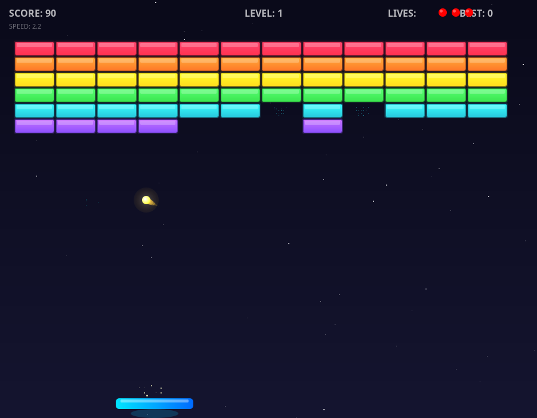
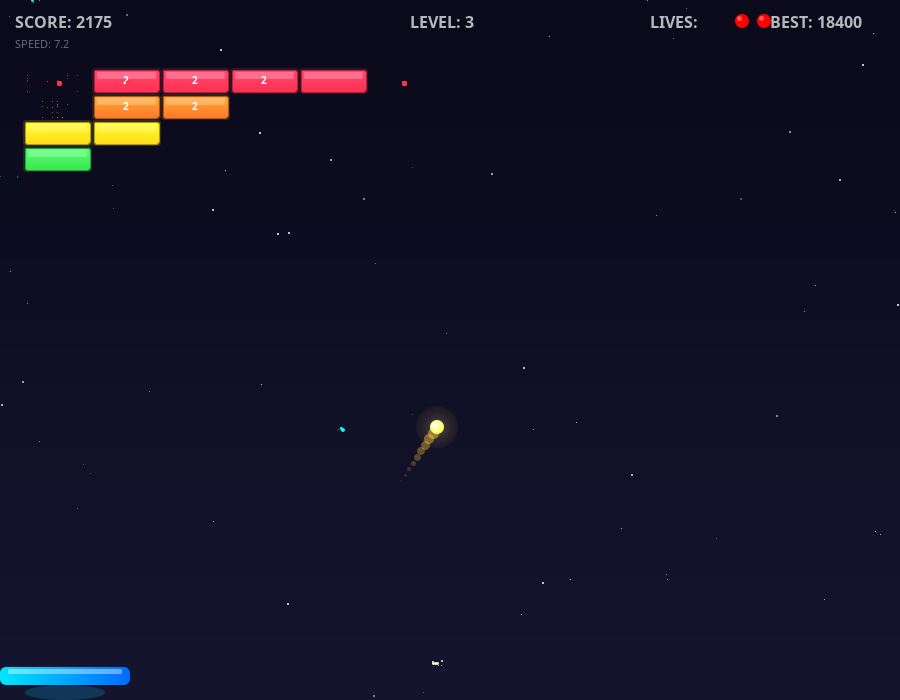

# ⚡ Arkanoid

Классическая игра **Arkanoid** на Java Swing с неоновой графикой, частицами и системой уровней — без внешних зависимостей.


## Скриншоты

| Игровой процесс | Уровень 3 |
|---|---|
|  |  |
| Сетка кирпичей, мяч со следом, частицы от разбитых кирпичей | Кирпичи с 2 HP, пробоины, рекорд в HUD |

## Возможности

- 🎨 Неоновая визуальная стилизация — свечение, градиенты, анимированный фон со звёздами
- ✨ Система частиц — взрывы при разрушении кирпичей, искры при ударах
- 🔥 След мяча (trail)
- 📈 Система уровней — после уничтожения всех кирпичей скорость увеличивается
- 💪 Кирпичи с 2 HP на верхних рядах (начиная со 2-го уровня)
- 🏆 Рекорд (high score) в рамках сессии
- 🎯 Угол отскока зависит от места удара по платформе

## Системные требования

- Linux x86_64 — для нативной сборки
- Или Java 17+ — для JAR-версии

## Готовые сборки

Релиз: [v1.0.0](https://github.com/dzolotarev/Arkanoid/releases/tag/v1.0.0)

| Файл | Описание |
|------|----------|
| `arkanoid-1.0.0.jar` | Универсальный JAR, нужен только Java 17+ |
| `arkanoid-1.0.0-linux-x64.tar.gz` | Нативный ELF-лаунчер + урезанный JRE внутри (jlink) |

## Установка и запуск

### JAR-сборка

```bash
java -jar arkanoid-1.0.0.jar
```

### Нативная сборка

```bash
tar xzf arkanoid-1.0.0-linux-x64.tar.gz
./Arkanoid/bin/Arkanoid
```

Внутри архива — свой JRE, собранный `jlink` (`--strip-debug --no-header-files --no-man-pages --compress=2`) из Temurin (Eclipse Adoptium), поэтому Java на машине не нужна: app-image ~54 МБ, архив ~32 МБ.

## Управление

| Клавиша | Действие |
|---------|----------|
| ← / → | Движение платформы |
| P / Esc | Пауза |
| Space | Рестарт |

## Сборка из исходников

### Gradle (рекомендуется)

```bash
# JAR
./gradlew jar
java -jar build/libs/arkanoid-1.0.0.jar

# Нативный app-image
./gradlew nativeImage
./build/jpackage/Arkanoid/bin/Arkanoid
```

`nativeImage` использует `jpackage` из `PATH` (или переменную окружения `JPACKAGE`) и `--add-modules java.base,java.desktop`. Внутрь app-image попадает JRE этого JDK — релиз собран на Temurin:

```bash
JPACKAGE=/path/to/temurin-17/bin/jpackage ./gradlew packageDist
```

### Напрямую через javac

```bash
javac -d out $(find src/main/java -name '*.java')
jar cfe arkanoid.jar com.arcanoid.Main -C out .
java -jar arkanoid.jar
```

## Структура проекта

```
arkanoid/
├── docs/                     # скриншоты для README и релиза
├── src/main/java/com/arcanoid/
│   ├── Main.java             # точка входа
│   ├── GameFrame.java        # окно JFrame
│   ├── GamePanel.java        # игровая логика и рендеринг
│   └── ConsoleArkanoid.java  # консольная версия той же игры
├── build/dist/               # готовые сборки (вне git)
├── LICENSE                   # MIT
├── build.gradle.kts          # конфигурация Gradle + таск nativeImage
└── settings.gradle.kts       # имя проекта
```

## License

MIT — подробности в [LICENSE](LICENSE).
